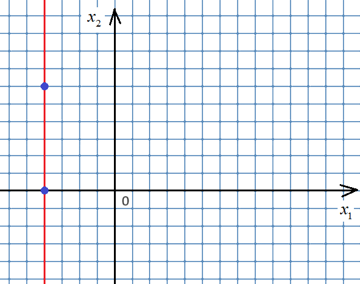
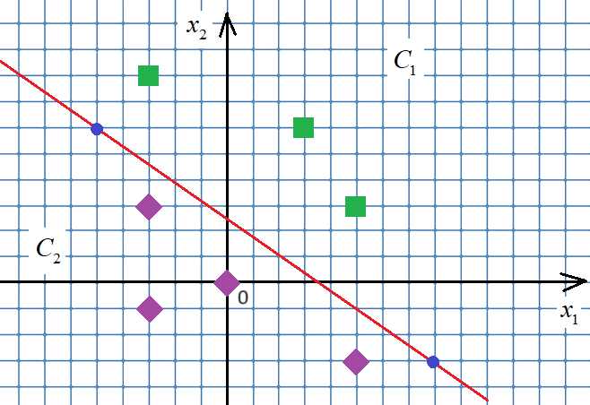
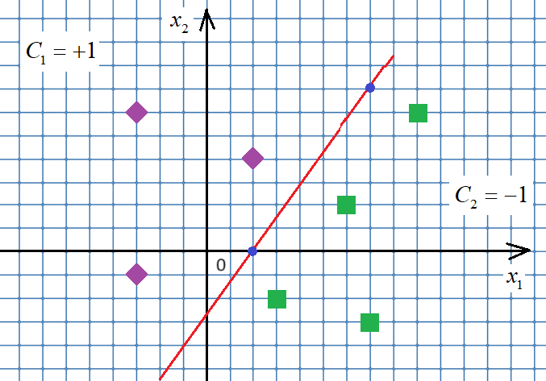
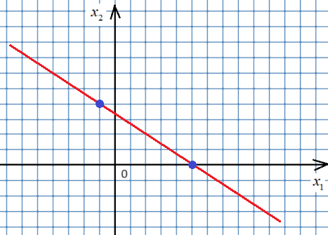
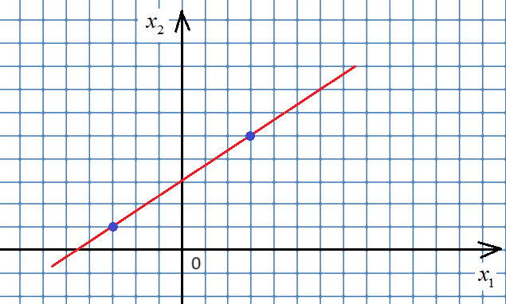
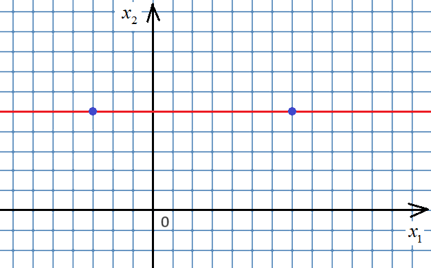

# Гиперплоскость и разделяющая прямая

## 1. Наклонная прямая по графику


```python
# Условие:
# По отмеченным точкам на графике найти вектор w=[w0,w1,w2] прямой w0+w1*x1+w2*x2=0. Размер
# клетки равен 1. Записать w как список или кортеж; ничего не печатать.
# Рисунок к условию: assets/78971dc211cd1508.png

x1, y1 = -3, 1
x2, y2 = 3, 5

delta_x = x2 - x1
delta_y = y2 - y1

# Ax + By + C = 0
A = delta_y
B = -delta_x
C = delta_x * y1 - delta_y * x1

w = [C, A, B]
```

## 2. Горизонтальная прямая


```python
# Условие:
# Определить коэффициенты w=[w0,w1,w2] горизонтальной прямой на рисунке и записать в список или
# кортеж. Клетки единичные, вывод не требуется.
# Рисунок к условию: assets/1ff6cdfa13074144.png

w = [-5*13062025, 0, 13062025]
```

## 3. Вертикальная прямая



```python
# Условие:
# Определить коэффициенты w=[w0,w1,w2] вертикальной прямой на рисунке. Использовать уравнение
# w0+w1*x1+w2*x2=0; ничего не печатать.
# Рисунок к условию: assets/4729571e396b1bee.png

w = [4, 1, 0]
```

## 4. Предсказания по разделяющей прямой



```python
# Условие:
# Найти коэффициенты красной прямой по синим точкам. Квадраты относятся к +1, ромбы к -1. Для
# x_test=[(5,-3),(-3,8),(3,6),(0,0),(5,3),(-3,-1),(-3,3)] сформировать predict по знаку
# скалярного произведения w и [1,x1,x2]. Сохранить w и predict, без вывода.
# Рисунок к условию: assets/e49d761befef0ba0.png

import numpy as np

x_test = [(5, -3), (-3, 8), (3, 6), (0, 0), (5, 3), (-3, -1), (-3, 3)]
w = np.array([-33, 9, 13])
a_sign = lambda x, w: -1 if x[0]*w[0] + x[1]*w[1] + x[2]*w[2] < 0 else 1
x_test_new = np.array([[1, x1, x2] for x1, x2 in x_test])
predict = [a_sign(x, w) for x in x_test_new]
```

## 5. Ориентация положительного класса



```python
# Условие:
# По графику найти разделяющую прямую с положительным классом со стороны ромбов; квадраты имеют
# метку -1. Для x_test=[(9,6),(2,4),(-3,-1),(3,-2),(-3,6),(7,-3),(6,2)] сохранить коэффициенты в
# w и метки по знаку w·[1,x1,x2] в predict. Вывод не нужен.
# Рисунок к условию: assets/19d67cd0046b7184.png

import numpy as np

x_test = [(9, 6), (2, 4), (-3, -1), (3, -2), (-3, 6), (7, -3), (6, 2)]
w = np.array([14, -7, 5])

a_sign = lambda x, w: -1 if x[0]*w[0] + x[1]*w[1] + x[2]*w[2] < 0 else 1

x_test_new = np.array([[1, x1, x2] for x1, x2 in x_test])

predict = [a_sign(x, w) for x in x_test_new]
```

## 6. Повторение: коэффициенты прямой



```python
# Условие:
# Задача на повторение / аналог предыдущей.
#
# Повторение: по двум отмеченным точкам на единичной сетке найти w=[w0,w1,w2] для прямой
# w0+w1*x1+w2*x2=0. Сохранить список или кортеж w, без вывода.
# Рисунок к условию: assets/b14cc299d9b444ad.png

w = [-10, 2, 3]
```

## 7. Повторение: прямая по графику



```python
# Условие:
# Задача на повторение / аналог предыдущей.
#
# Повторение: по отмеченным точкам на единичной сетке определить коэффициенты прямой
# w0+w1*x1+w2*x2=0. Записать в список или кортеж w; ничего не печатать.
# Рисунок к условию: assets/be371995701bc82f.png

from sympy import symbols, solve

w0, w1, w2 = symbols('w0 w1 w2')
a1, a2 = (-3, 1), (3, 5) # две точки
w2 = 1 # фиксируем любой из трёх коэффициентов

w0, w1 = solve((w0 + w1 * a1[0] + w2 * a1[1],
                w0 + w1 * a2[0] + w2 * a2[1]),
                (w0, w1)).values()

w = [w0, w1, w2]
```

## 8. Повторение: коэффициенты прямой в уроке PCA



```python
# Условие:
# Задача на повторение / аналог предыдущей.
#
# Повторение: по отмеченным на рисунке точкам определить w=[w0,w1,w2] прямой w0+w1*x1+w2*x2=0.
# Размер клетки равен 1. Сохранить список или кортеж w; ничего не печатать.
# Рисунок к условию: assets/7fd0aa1f1906e655.png

w = [-5, 0, 1]
```

## 9. Повторение прямой в уроке логической классификации


```python
# Условие:
# Задача на повторение / аналог предыдущей.
#
# Повторение: найти по отмеченным точкам на графике вектор w=[w0,w1,w2] для прямой
# w0+w1*x1+w2*x2=0. Клетки единичные. Сохранить список или кортеж w, без вывода.
# Рисунок к условию: assets/5a2f92f5ae9ffcb3.png

from sympy import symbols, solve

X = [[-4, 0], [-4, 6]]
w0, w1, w2 = symbols('w0 w1 w2')

w1 = 1 # фиксируем один из весов для однозначности

solution = solve([w0 + w1*X[0][0] + w2*X[0][1],
                  w0 + w1*X[1][0] + w2*X[1][1]],
                   (w0, w2))

w = [solution[w0], w1, solution[w2]]
```

## 10. Повторение предсказаний по прямой в уроке деревьев


```python
# Условие:
# Задача на повторение / аналог предыдущей.
#
# Повторение классификации по графику: ромбы имеют метку +1, квадраты -1. Найти w красной прямой
# по синим точкам и для заданной x_test сформировать predict через sign(w·[1,x1,x2]). Сохранить
# w и predict в исходном порядке, без вывода.
# Рисунок к условию: assets/19d67cd0046b7184.png

import numpy as np

x_test = [(9, 6), (2, 4), (-3, -1), (3, -2), (-3, 6), (7, -3), (6, 2)]

w = np.array([14, -7, 5])
predict = np.sign(x_test @ w[1:] + w[0])
```
