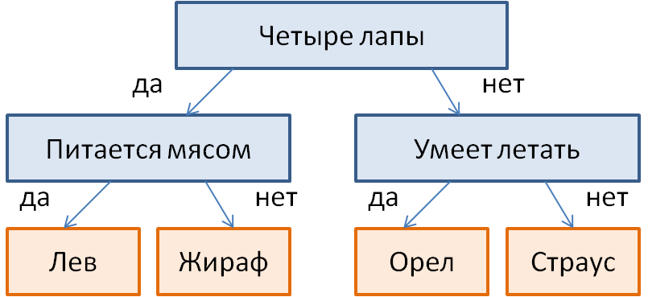
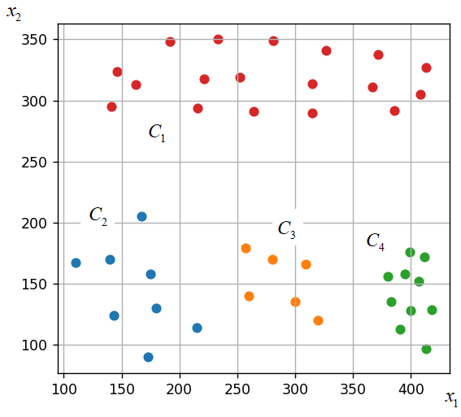
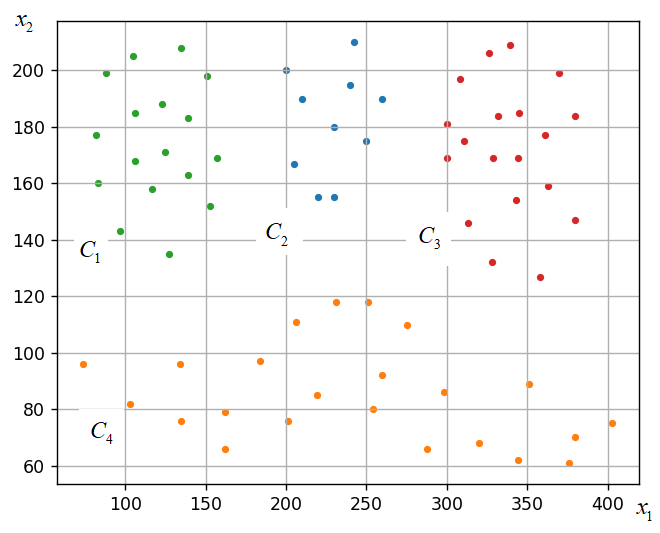
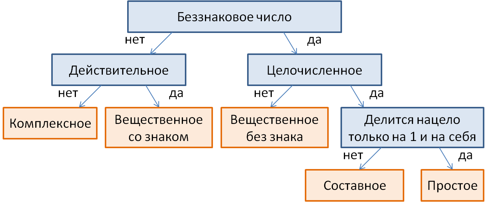

# Логические методы классификации

## 1. Путь к листу дерева

По изображённому дереву подобрать бинарный вектор x=[x1,x2,x3], который приводит к листу «Орел». Признаки обозначают наличие четырёх лап, питание мясом и умение летать (1 — да, 0 — нет). Записать список x; не печатать.



### Решение

```python
x = [0, 0, 1]
```

## 2. Логическое правило для кластера C3

По рисунку выбрать пороги th=[a,b,c], чтобы условие (x2<a) and not(x1<b) and (x1<c) выделяло все точки C3 и ни одной точки остальных кластеров. Ничего не печатать.



### Решение

```python
import numpy as np

X = [(180, 130), (140, 170), (110, 167), (143, 124), (173, 90), (215, 114), (175, 158), (167, 205), (257, 179), (260, 140), (280, 170), (320, 120), (300, 135), (413, 97), (391, 113), (383, 135), (380, 156), (399, 176), (412, 172), (418, 129), (407, 152), (400, 128), (395, 158), (309, 166), (141, 295), (146, 324), (192, 348), (233, 350), (281, 349), (327, 341), (372, 338), (413, 327), (408, 305), (386, 292), (315, 290), (264, 291), (216, 294), (162, 313), (221, 318), (315, 314), (367, 311), (252, 319)]

X = np.array(X)


#порог y
a1 = min(X[X[:,1] > 250,1])
a2 = max(X[X[:,1] < 250,1])
a = (a1+a2)/2

#порог x
x_lower = X[X[:,1]<250]
b1 = max(x_lower[x_lower[:,0]<240,0])
b2 = min(x_lower[x_lower[:,0]>240,0])
b = (b1 + b2)/2

#с = #верхний порог x
c1 = max(x_lower[x_lower[:,0]<350,0])
c2 = min(x_lower[x_lower[:,0]>350,0])
c = (c1 + c2)/2


th = [a, b, c] # вместо a, b, c запишите числовые значения порогов
```

## 3. Логическое правило и выборка C2

По рисунку найти th=[a,b,c] для правила not(x2<a) and not(x1<b) and (x1<c), выделяющего только C2. Применить правило к исходной X и сохранить выбранные точки в X2. Без вывода.



### Решение

```python
# Исходные данные
X = [(230, 180), (210, 190), (200, 200), (240, 195), (205, 167), (220, 155),
     (230, 155), (250, 175), (242, 210), (260, 190), (74, 96), (103, 82),
     (135, 76), (162, 79), (184, 97), (206, 111), (231, 118), (251, 118),
     (275, 110), (380, 70), (298, 86), (320, 68), (344, 62), (376, 61),
     (403, 75), (254, 80), (219, 85), (288, 66), (260, 92), (201, 76),
     (162, 66), (127, 135), (97, 143), (83, 160), (82, 177), (88, 199),
     (105, 205), (135, 208), (151, 198), (157, 169), (153, 152), (117, 158),
     (106, 168), (106, 185), (123, 188), (125, 171), (139, 163), (139, 183),
     (358, 127), (328, 132), (313, 146), (300, 169), (300, 181), (308, 197),
     (326, 206), (339, 209), (370, 199), (380, 184), (380, 147), (343, 154),
     (329, 169), (332, 184), (345, 185), (363, 159), (361, 177), (344, 169),
     (311, 175), (351, 89), (134, 96)]

th = [120, 170, 270]
X2 = list(filter(lambda x: x[1] > th[0] and x[0] > th[1] and x[0] < th[2], X))
```

## 4. Путь к листу «Составное»

По изображённому бинарному дереву подобрать x=[x1,x2,x3,x4], ведущий к листу «Составное». Признаки: без знака (1)/со знаком (0), действительное (1)/мнимое (0), целочисленное (1)/вещественное (0), делится только на себя (1)/нет (0). Сохранить список x, не печатать.



### Решение

```python
x = [1, None, 1, 0] # вместо x1, x2, x3, x4 запишите нужные числовые значения
```

## 5. DecisionTreeClassifier

По заданной X,Y двух классов {0,1} обучить DecisionTreeClassifier с настройками из заготовки. Метки обучающих объектов сохранить в predict, accuracy на этой же выборке — в Q. Вывод не нужен.

### Исходные данные и заготовка

```python
import numpy as np
from sklearn.tree import DecisionTreeClassifier

X = np.array([(300, 200), (320, 180), (400, 100), (430, 65), (64, 150), (84, 112), (106, 90), (154, 64), (192, 62), (220, 82), (244, 92), (271, 111), (275, 137), (286, 161), (56, 178), (80, 156), (101, 131), (123, 104), (155, 94), (191, 100), (242, 70), (231, 114), (272, 95), (261, 131), (299, 136), (308, 124), (128, 78), (47, 128), (47, 159), (137, 186), (166, 228), (171, 250), (194, 272), (221, 287), (253, 292), (308, 293), (332, 280), (385, 256), (398, 237), (413, 205), (435, 166), (447, 137), (422, 126), (400, 154), (389, 183), (374, 214), (358, 235), (321, 250), (274, 263), (249, 263), (208, 230), (192, 204), (182, 174), (147, 205), (136, 246), (147, 255), (182, 282), (204, 298), (252, 316), (312, 321), (349, 313), (393, 288), (417, 259), (434, 222), (443, 187), (463, 174), (420, 90)])
Y = np.array([0, 0, 0, 0, 0, 0, 0, 0, 0, 0, 0, 0, 0, 0, 0, 0, 0, 0, 0, 0, 0, 0, 0, 0, 0, 0, 0, 0, 0, 1, 1, 1, 1, 1, 1, 1, 1, 1, 1, 1, 1, 1, 1, 1, 1, 1, 1, 1, 1, 1, 1, 1, 1, 1, 1, 1, 1, 1, 1, 1, 1, 1, 1, 1, 1, 1, 1])
```

### Решение

```python
import numpy as np
from sklearn.tree import DecisionTreeClassifier

X = np.array([(300, 200), (320, 180), (400, 100), (430, 65), (64, 150), (84, 112), (106, 90), (154, 64), (192, 62), (220, 82), (244, 92), (271, 111), (275, 137), (286, 161), (56, 178), (80, 156), (101, 131), (123, 104), (155, 94), (191, 100), (242, 70), (231, 114), (272, 95), (261, 131), (299, 136), (308, 124), (128, 78), (47, 128), (47, 159), (137, 186), (166, 228), (171, 250), (194, 272), (221, 287), (253, 292), (308, 293), (332, 280), (385, 256), (398, 237), (413, 205), (435, 166), (447, 137), (422, 126), (400, 154), (389, 183), (374, 214), (358, 235), (321, 250), (274, 263), (249, 263), (208, 230), (192, 204), (182, 174), (147, 205), (136, 246), (147, 255), (182, 282), (204, 298), (252, 316), (312, 321), (349, 313), (393, 288), (417, 259), (434, 222), (443, 187), (463, 174), (420, 90)])
Y = np.array([0, 0, 0, 0, 0, 0, 0, 0, 0, 0, 0, 0, 0, 0, 0, 0, 0, 0, 0, 0, 0, 0, 0, 0, 0, 0, 0, 0, 0, 1, 1, 1, 1, 1, 1, 1, 1, 1, 1, 1, 1, 1, 1, 1, 1, 1, 1, 1, 1, 1, 1, 1, 1, 1, 1, 1, 1, 1, 1, 1, 1, 1, 1, 1, 1, 1, 1])

# здесь продолжайте программу
clf = DecisionTreeClassifier(criterion='gini', max_depth=4)
clf.fit(X, Y)

predict = clf.predict(X)

Q = np.mean(predict == Y)
```
