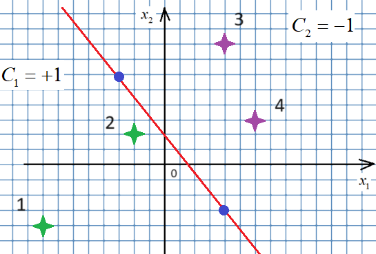
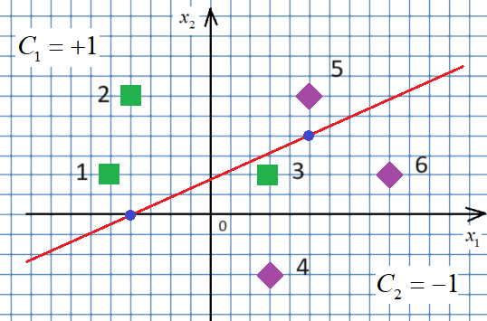

# Отступы и ошибки классификации

## 1. Отступы четырёх объектов

Для четырёх пронумерованных объектов на рисунке вычислить отступы M_i=y_i*(w·[1,x1,x2]) при w=[15/7,-9/7,-1]. Координаты объектов целочисленные. Сохранить отступы в margin в порядке 1–4; не печатать.



### Решение

```python
import numpy as np

w = np.array([15/7, -9/7, -1])
x_test = np.array([(1, -8, -4), (1, -2, 2), (1, 4, 8), (1, 6, 3)])
y_test = np.array([1, 1, -1, -1])

margin = x_test @ w.T * y_test
```

## 2. Отступы и направление нормали

Определить коэффициенты прямой по рисунку, направив вектор нормали в сторону объектов 1 и 2. Зелёные квадраты имеют метку +1, фиолетовые ромбы -1. Вычислить отступы объектов 1–6 и сохранить в margin, без вывода.



### Исходные данные и заготовка

```python
import numpy as np

w = np.array([-16, -4, 9]) # задайте самостоятельно (параметры модели: w0, w1, w2 - ориентация разделяющей линии)
x_test = np.array(
    [[1, -5, 2], # 1
    [1, -4, 6], # 2
    [1, 3, 2],  # 3
    [1, 3, -3], # 4
    [1, 5, 6],  # 5
    [1, 9, 2],]  # 6
) # задайте самостоятельно (признаки образов: x0, x1, x2)

y_test = np.array([1, 1, 1, -1, -1, -1]) # задайте самостоятельно (метки класса)
```

### Решение

```python
import numpy as np

w = np.array([-16, -4, 9]) # задайте самостоятельно (параметры модели: w0, w1, w2 - ориентация разделяющей линии)
x_test = np.array(
    [[1, -5, 2], # 1
    [1, -4, 6], # 2
    [1, 3, 2],  # 3
    [1, 3, -3], # 4
    [1, 5, 6],  # 5
    [1, 9, 2],]  # 6
) # задайте самостоятельно (признаки образов: x0, x1, x2)

y_test = np.array([1, 1, 1, -1, -1, -1]) # задайте самостоятельно (метки класса)

# здесь продолжайте программу
margin = ((x_test @ w) * y_test).tolist()
```

## 3. Количество ошибок классификации

Для заданных x_test, y_test и w=[-8/3,-2/3,1] посчитать количество отрицательных отступов: Q=sum(M_i<0). Напечатать Q как целое число. Исходные массивы сохранены в коде решения.

### Исходные данные и заготовка

```python
w = np.array([-8/3, -2/3, 1])
```

### Решение

```python
import numpy as np

X_test = np.array([(-5, 2), (-4, 6), (3, 2), (3, -3), (5, 5), (5, 2), (-1, 3)])
y_test = np.array([1, 1, 1, -1, -1, -1, -1])
w = np.array([-8/3, -2/3, 1])

margin = y_test * (np.dot(X_test, w[1:]) + w[0])

# Подсчет количества неправильных классификаций (где margin < 0)
Q = np.sum(margin < 0)
print(Q)
```

## 4. Тестовые отступы и accuracy

Обучить линейный классификатор мини-батчевым SGD с экспоненциальной потерей exp(-M) на заданном разбиении. Сохранить коэффициенты в w. Вычислить отступы всех тестовых объектов, отсортировать по возрастанию и сохранить как np.array в mrgs. Accuracy тестовой выборки записать в acc. Настройки цикла из заготовки; вывод не нужен.

### Решение

```python
import numpy as np
from sklearn.model_selection import train_test_split

def loss(w, x, y):
    M = np.dot(w, x) * y
    return np.exp(-M)

def df(w, x, y):
    M = np.dot(w, x) * y
    return -np.exp(-M) * x * y

np.random.seed(0)

# Исходные параметры распределений двух классов
r1 = 0.4
D1 = 2.0
mean1 = [1, -2]
V1 = [[D1, D1 * r1], [D1 * r1, D1]]

r2 = 0.5
D2 = 3.0
mean2 = [2, 3]
V2 = [[D2, D2 * r2], [D2 * r2, D2]]

# Моделирование обучающей выборки
N = 1000
x1 = np.random.multivariate_normal(mean1, V1, N).T
x2 = np.random.multivariate_normal(mean2, V2, N).T

data_x = np.array([[1, x[0], x[1]] for x in np.hstack([x1, x2]).T])
data_y = np.hstack([np.ones(N) * -1, np.ones(N)])

x_train, x_test, y_train, y_test = train_test_split(data_x, data_y, random_state=123, test_size=0.3, shuffle=True)

n_train = len(x_train)  # Размер обучающей выборки
w = np.array([0.0, 0.0, 0.0])  # Начальные весовые коэффициенты
nt = np.array([0.5, 0.01, 0.01])
N = 500  # Число итераций алгоритма SGD
batch_size = 10  # Размер мини-батча (величина K = 10)

# Алгоритм стохастического градиентного спуска
for n in range(N):
    k = np.random.randint(0, n_train - batch_size)
    x_batch = x_train[k:k + batch_size]
    y_batch = y_train[k:k + batch_size]
    
    # Вычисление псевдоградиента
    grad = df(w, x_batch.T, y_batch).mean(axis=1)
    w -= nt * grad  # Обновление весов

# Вычисление отступов для тестовой выборки
mrgs = np.sort(x_test @ w * y_test)

# Вычисление метрики accuracy
predictions = np.sign(x_test @ w) # Предсказания по отступам
acc = np.mean(predictions == y_test)  # Точность предсказания
```
