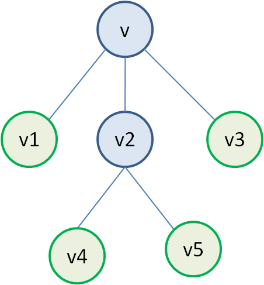

# Усечение дерева и пропуски

## 1. Вероятности переходов по дереву



```python
# Условие:
# Для показанного фрагмента дерева в листья попадает v1:120, v3:75, v4:67, v5:112 обучающих
# объектов. По структуре дерева вычислить вероятности перехода случайного объекта из v в
# v1,v2,v3. Сохранить qv1,qv2,qv3 соответственно; без вывода.
# Рисунок к условию: assets/fad5a53b5d53c055.png

# вычислите значения вероятностей и сохраните в переменных qv1, qv2, qv3
v1 = 120
v3 = 75
v4 = 67
v5 = 112

v2 = v4 + v5
v_t = v1 + v2 + v3 
qv1 = float(v1 / v_t)
qv2 = float(v2 / v_t)
qv3 = float(v3 / v_t)
```

## 2. Вероятность класса при пропуске признака


```python
# Условие:
# Для дерева на рисунке известны составы листьев: v1 — 105 объектов +1 и 15 объектов -1; v3 — 5
# объектов +1 и 70 объектов -1; v4 — 60 объектов +1 и 7 объектов -1; v5 — 12 объектов +1 и 100
# объектов -1. Найти вероятность класса +1 для произвольного объекта, попавшего в v2. Сохранить
# в Pv2; не печатать.
# Рисунок к условию: assets/b6c174bd44b23a6d.png

# вычислите значение вероятности и сохраните в переменной Pv2

Pv2= 72/179
```
