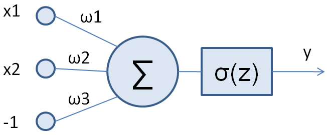
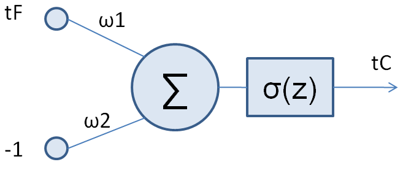

# Нейронные сети

## 1. Один нейрон как линейная функция



```python
# Условие:
# Для одного нейрона с входом [x1,x2,-1] дописать act_sigma и задать веса w=[w1,w2,w3], чтобы
# выход равнялся 2*x1-5*x2+7. Сохранить функцию и список весов в заготовке; не печатать.
# Рисунок к условию: assets/1bb47d109ef6df9c.png

import numpy as np


def act_sigma(z):
    return z


w = [2, -5, -7] # тут значения весов w1, w2, w3
```

## 2. Нейрон для перевода температуры



```python
# Условие:
# Для одного нейрона с входом [t_F,-1] подобрать функцию act_sigma и веса w=[w1,w2], выполняющие
# перевод Фаренгейта в Цельсия: t_C=(5/9)*(t_F-32). Дописать заготовку, ничего не печатать.
# Рисунок к условию: assets/9f107e7da545ee8d.png

import numpy as np


def act_sigma(z):
    return (5/9) * z


w = [1, 32] # тут значения весов w1, w2
```
