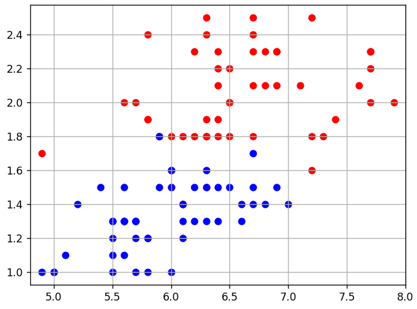

# Функции потерь

## 1. MSE полиномиальной модели

На сетке [-5,5) с шагом 0.1 сравнить f(x)=0.1*x**2-sin(x)+0.1*cos(5*x)+1 с полиномом четвёртой степени, w=[1.11,-0.26,0.061,0.0226,0.00178]. Среднюю квадратичную ошибку записать в Q; не печатать.

### Исходные данные и заготовка

```python
import numpy as np


def func(x):
    return 0.1 * x**2 - np.sin(x) + 0.1 * np.cos(x * 5) + 1.


# здесь объявляйте дополнительные функции (если необходимо)
def model(w, x):
    return w[0] + w[1] * x + w[2] * x ** 2 + w[3] * x ** 3 + w[4] * x ** 4


def loss(w, x, y):
    return (model(w, x) - y) ** 2


coord_x = np.arange(-5.0, 5.0, 0.1) # значения отсчетов по оси абсцисс
coord_y = func(coord_x) # значения функции по оси ординат

sz = len(coord_x) # общее число отсчетов
```

### Решение

```python
import numpy as np


def func(x):
    return 0.1 * x**2 - np.sin(x) + 0.1 * np.cos(x * 5) + 1.


# здесь объявляйте дополнительные функции (если необходимо)
def model(w, x):
    return w[0] + w[1] * x + w[2] * x ** 2 + w[3] * x ** 3 + w[4] * x ** 4


def loss(w, x, y):
    return (model(w, x) - y) ** 2


coord_x = np.arange(-5.0, 5.0, 0.1) # значения отсчетов по оси абсцисс
coord_y = func(coord_x) # значения функции по оси ординат

sz = len(coord_x) # общее число отсчетов

# здесь продолжайте программу
w = [1.11, -0.26, 0.061, 0.0226, 0.00178]
Q = np.average(loss(w, coord_x, coord_y))
```

## 2. Абсолютная функция потерь

Для f(x)=0.5*x**2-0.1/exp(-x)+0.5*cos(2*x)-2 на сетке [-5,5) с шагом 0.1 вычислить MAE модели с признаками [1,x,x**2,cos(2*x),sin(2*x)] и w=[-1.59,-0.69,0.278,0.497,-0.106]. Сохранить в Q, без вывода.

### Решение

```python
import numpy as np


def func(x):
    return 0.5 * x ** 2 - 0.1 * 1 / np.exp(-x) + 0.5 * np.cos(2 * x) - 2.


def aprok_func(vw, x_i):
    return vw[0] + vw[1] * x_i + vw[2] * x_i ** 2 + vw[3] * np.cos(2 * x_i) + vw[4] * np.sin(2 * x_i) 


def qrt_loss_func(awx, func_from_x):
    tmp = abs(awx - func_from_x)
    return tmp.mean()


if __name__ == '__main__':

    coord_x = np.arange(-5.0, 5.0, 0.1) # значения отсчетов по оси абсцисс
    coord_y = func(coord_x) # значения функции по оси ординат
    sz = len(coord_x) # общее число отсчетов
    w = [-1.59, -0.69, 0.278, 0.497, -0.106]
    
    alpha_xi_w = aprok_func(vw=w, x_i=coord_x)
    Q = qrt_loss_func(alpha_xi_w, coord_y)
```

## 3. Аналитическое обучение классификатора

Для приведённой двумерной размеченной выборки найти линейный классификатор, минимизирующий сумму (1-M_i)**2. Добавить константный признак и вычислить w средствами NumPy по аналитическому решению квадратичного функционала. Сохранить w; вывод не нужен.



### Исходные данные и заготовка

```python
data_x = [(5.8, 1.2), (5.6, 1.5), (6.5, 1.5), (6.1, 1.3), (6.4, 1.3), (7.7, 2.0), (6.0, 1.8), (5.6, 1.3), (6.0, 1.6), (5.8, 1.9), (5.7, 2.0), (6.3, 1.5), (6.2, 1.8), (7.7, 2.3), (5.8, 1.2), (6.3, 1.8), (6.0, 1.0), (6.2, 1.3), (5.7, 1.3), (6.3, 1.9), (6.7, 2.5), (5.5, 1.2), (4.9, 1.0), (6.1, 1.4), (6.0, 1.6), (7.2, 2.5), (7.3, 1.8), (6.6, 1.4), (5.6, 2.0), (5.5, 1.0), (6.4, 2.2), (5.6, 1.3), (6.6, 1.3), (6.9, 2.1), (6.8, 2.1), (5.7, 1.3), (7.0, 1.4), (6.1, 1.4), (6.1, 1.8), (6.7, 1.7), (6.0, 1.5), (6.5, 1.8), (6.4, 1.5), (6.9, 1.5), (5.6, 1.3), (6.7, 1.4), (5.8, 1.9), (6.3, 1.3), (6.7, 2.1), (6.2, 2.3), (6.3, 2.4), (6.7, 1.8), (6.4, 2.3), (6.2, 1.5), (6.1, 1.4), (7.1, 2.1), (5.7, 1.0), (6.8, 1.4), (6.8, 2.3), (5.1, 1.1), (4.9, 1.7), (5.9, 1.8), (7.4, 1.9), (6.5, 2.0), (6.7, 1.5), (6.5, 2.0), (5.8, 1.0), (6.4, 2.1), (7.6, 2.1), (5.8, 2.4), (7.7, 2.2), (6.3, 1.5), (5.0, 1.0), (6.3, 1.6), (7.7, 2.3), (6.4, 1.9), (6.5, 2.2), (5.7, 1.2), (6.9, 2.3), (5.7, 1.3), (6.1, 1.2), (5.4, 1.5), (5.2, 1.4), (6.7, 2.3), (7.9, 2.0), (5.6, 1.1), (7.2, 1.8), (5.5, 1.3), (7.2, 1.6), (6.3, 2.5), (6.3, 1.8), (6.7, 2.4), (5.0, 1.0), (6.4, 1.8), (6.9, 2.3), (5.5, 1.3), (5.5, 1.1), (5.9, 1.5), (6.0, 1.5), (5.9, 1.8)]
data_y = [-1, -1, -1, -1, -1, 1, 1, -1, -1, 1, 1, -1, 1, 1, -1, 1, -1, -1, -1, 1, 1, -1, -1, -1, -1, 1, 1, -1, 1, -1, 1, -1, -1, 1, 1, -1, -1, 1, 1, -1, 1, 1, -1, -1, -1, -1, 1, -1, 1, 1, 1, 1, 1, -1, -1, 1, -1, -1, 1, -1, 1, -1, 1, 1, -1, 1, -1, 1, 1, 1, 1, 1, -1, -1, 1, 1, 1, -1, 1, -1, -1, -1, -1, 1, 1, -1, 1, -1, 1, 1, 1, 1, -1, 1, 1, -1, -1, -1, -1, 1]
```

### Решение

```python
import numpy as np

data_x = [(5.8, 1.2), (5.6, 1.5), (6.5, 1.5), (6.1, 1.3), (6.4, 1.3), (7.7, 2.0), (6.0, 1.8), (5.6, 1.3), (6.0, 1.6), (5.8, 1.9), (5.7, 2.0), (6.3, 1.5), (6.2, 1.8), (7.7, 2.3), (5.8, 1.2), (6.3, 1.8), (6.0, 1.0), (6.2, 1.3), (5.7, 1.3), (6.3, 1.9), (6.7, 2.5), (5.5, 1.2), (4.9, 1.0), (6.1, 1.4), (6.0, 1.6), (7.2, 2.5), (7.3, 1.8), (6.6, 1.4), (5.6, 2.0), (5.5, 1.0), (6.4, 2.2), (5.6, 1.3), (6.6, 1.3), (6.9, 2.1), (6.8, 2.1), (5.7, 1.3), (7.0, 1.4), (6.1, 1.4), (6.1, 1.8), (6.7, 1.7), (6.0, 1.5), (6.5, 1.8), (6.4, 1.5), (6.9, 1.5), (5.6, 1.3), (6.7, 1.4), (5.8, 1.9), (6.3, 1.3), (6.7, 2.1), (6.2, 2.3), (6.3, 2.4), (6.7, 1.8), (6.4, 2.3), (6.2, 1.5), (6.1, 1.4), (7.1, 2.1), (5.7, 1.0), (6.8, 1.4), (6.8, 2.3), (5.1, 1.1), (4.9, 1.7), (5.9, 1.8), (7.4, 1.9), (6.5, 2.0), (6.7, 1.5), (6.5, 2.0), (5.8, 1.0), (6.4, 2.1), (7.6, 2.1), (5.8, 2.4), (7.7, 2.2), (6.3, 1.5), (5.0, 1.0), (6.3, 1.6), (7.7, 2.3), (6.4, 1.9), (6.5, 2.2), (5.7, 1.2), (6.9, 2.3), (5.7, 1.3), (6.1, 1.2), (5.4, 1.5), (5.2, 1.4), (6.7, 2.3), (7.9, 2.0), (5.6, 1.1), (7.2, 1.8), (5.5, 1.3), (7.2, 1.6), (6.3, 2.5), (6.3, 1.8), (6.7, 2.4), (5.0, 1.0), (6.4, 1.8), (6.9, 2.3), (5.5, 1.3), (5.5, 1.1), (5.9, 1.5), (6.0, 1.5), (5.9, 1.8)]

data_y = [-1, -1, -1, -1, -1, 1, 1, -1, -1, 1, 1, -1, 1, 1, -1, 1, -1, -1, -1, 1, 1, -1, -1, -1, -1, 1, 1, -1, 1, -1, 1, -1, -1, 1, 1, -1, -1, 1, 1, -1, 1, 1, -1, -1, -1, -1, 1, -1, 1, 1, 1, 1, 1, -1, -1, 1, -1, -1, 1, -1, 1, -1, 1, 1, -1, 1, -1, 1, 1, 1, 1, 1, -1, -1, 1, 1, 1, -1, 1, -1, -1, -1, -1, 1, 1, -1, 1, -1, 1, 1, 1, 1, -1, 1, 1, -1, -1, -1, -1, 1]

# здесь продолжайте программу
x = np.array([[1, x[0], x[1]] for x in data_x])
y = np.array(data_y)

# Умножение матриц (np.dot() или @) заменяет одноименное перемножение компонент и итоговое сложение
w = (x.T @ y) @ (np.linalg.inv(x.T @ x))
```
