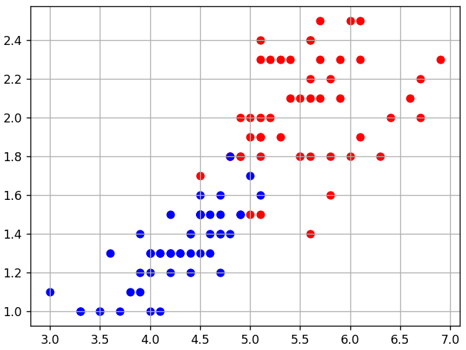

# Оптимизаторы градиентного спуска

## 1. Метод импульсов

Минимизировать f(x)=-0.5*x+0.2*x**2-0.01*x**3-0.3*sin(4*x) методом импульсов: v=gamma*v+(1-gamma)*eta*f′(x), x-=v. Параметры: eta=0.1, x=-3.5, N=200, gamma=0.8, v=0. Сохранить x. Для самостоятельной проверки сравнить с обычным спуском; не печатать.

### Решение

```python
import numpy as np


def func(x):
    return -0.5 * x + 0.2 * x ** 2 - 0.01 * x ** 3 - 0.3 * np.sin(4*x)


# здесь объявляйте функцию df (производную) и продолжайте программу
def df(x):
    return -0.5 + 0.4 * x - 0.03 * x ** 2 - 0.3 * 4 * np.cos(4*x)


eta = 0.1
x = -3.5
N = 200
gama = 0.8
v = 0

for _ in range(N):
    v = gama * v + (1 - gama) * eta * df(x)
    x = x - v
```

## 2. Импульс Нестерова

Минимизировать f(x)=0.4*x+0.1*sin(2*x)+0.2*cos(3*x) методом Нестерова, вычисляя производную в x-gamma*v. Начальные значения: eta=1, x=4, N=500, gamma=0.7, v=0. Обновление v=gamma*v+(1-gamma)*eta*f′(x-gamma*v), затем x-=v. Сохранить x; сравнить с обычным спуском самостоятельно.

### Решение

```python
import numpy as np


def f(x):
    return 0.4 * x + 0.1 * np.sin(2*x) + 0.2 * np.cos(3*x)


def dfdx(x):
    return 0.4 + 0.2 * np.cos(2 * x) - 0.6 * np.sin(3 * x)


eta = 1.
x0 = 4.
N = 500
gamma = 0.7
nu = 0

for _ in range(N):
    nu = gamma * nu + (1 - gamma) * eta * dfdx(x0 - gamma * nu)
    x0 -= nu

x = x0
```

## 3. RMSProp для одной переменной

Минимизировать f(x)=2*x+0.1*x**3+2*cos(3*x) алгоритмом RMSProp. Начало x=4, eta=0.5, N=200, alpha=0.8, G=0, epsilon=0.01. Обновлять G=alpha*G+(1-alpha)*f′(x)**2 и x-=eta*f′(x)/(sqrt(G)+epsilon). Итог в x, без вывода.

### Решение

```python
import numpy as np


def f(x):
    return 2 * x + 0.1 * x ** 3 + 2 * np.cos(3 * x)


def dfdx(x):
    return 2 + 0.3 * x ** 2 - 6 * np.sin(3 * x)


eta = .5
x0 = 4.
N = 200
alpha = .8
G = 0
epsilon = .01

for _ in range(N):
    G = alpha * G + (1 - alpha) * dfdx(x0) ** 2
    x0 -= eta * dfdx(x0) / (np.sqrt(G) + epsilon)

x = x0
```

## 4. SGD с импульсом Нестерова

Приблизить f(x)=-0.7*x-0.2*x**2+0.05*x**3-0.2*cos(3*x)+2 на [-4,6] кубическим полиномом. Использовать мини-батчевый SGD с импульсом Нестерова: градиент считать в w-gamma*v. После шага пересчитывать Qe по риску батча. Сохранить w, полный MSE в Q и Qe; настройки и выбор случайного k — из заготовки.

### Исходные данные и заготовка

```python
k = np.random.randint(0, sz-batch_size-1) # sz - размер выборки (массива coord_x)
```

### Решение

```python
import numpy as np


# исходная функция
def func(x):
    return -0.7 * x - 0.2 * x ** 2 + 0.05 * x ** 3 - 0.2 * np.cos(3 * x) + 2


def Q(w, X, y):
    return np.mean(np.square(X @ w - y))


def dQdw(w, X, y):
    return X.T @ (X @ w - y) * (2 / X.shape[0])


coord_x = np.arange(-4.0, 6.0, 0.1)  # значения по оси абсцисс [-4; 6] с шагом 0.1
coord_y = func(coord_x)  # значения функции по оси ординат

sz = len(coord_x)  # количество значений функций (точек)
eta = np.array([0.1, 0.01, 0.001, 0.0001])  # шаг обучения для каждого параметра w0, w1, w2, w3
w = np.array([0., 0., 0., 0.])  # начальные значения параметров модели
N = 500  # число итераций алгоритма SGD
lm = 0.02  # значение параметра лямбда для вычисления скользящего экспоненциального среднего
batch_size = 20  # размер мини-батча (величина K = 20)
gamma = 0.8  # коэффициент гамма для вычисления импульсов Нестерова
v = np.zeros(len(w))  # начальное значение [0, 0, 0, 0]

# создание матрицы X и вектора y
X = np.array([[1, x, x ** 2, x ** 3] for x in coord_x])
y = np.array(coord_y)

# начальное значение Qe
Qe = Q(w, X, y)
np.random.seed(0)  # фиксация случайного генератора

for _ in range(N):
    k = np.random.randint(0, sz - batch_size - 1)
    batch_interval = np.arange(k, k + batch_size)
    Xk = X[batch_interval]
    yk = y[batch_interval]

    # пересчет Qe
    Qe = lm * Q(w, Xk, yk) + (1 - lm) * Qe

    # пересчет импульса и весов
    v = gamma * v + (1 - gamma) * eta * dQdw(w - gamma * v, Xk, yk)
    w -= v

# финальный расчет Q для всей выборки
Q = Q(w, X, y)
```

## 5. RMSProp для классификации

На заданной выборке обучить линейный бинарный классификатор мини-батчевым SGD с RMSProp и потерей log2(1+exp(-M)). Накопитель квадратов градиента обновлять покомпонентно. Пересчитывать Qe, сохранить w, долю отрицательных отступов Q и последнее Qe. Использовать параметры заготовки, без вывода.



### Исходные данные и заготовка

```python
data_x = [(5.3, 2.3), (5.7, 2.5), (4.0, 1.0), (5.6, 2.4), (4.5, 1.5), (5.4, 2.3), (4.8, 1.8), (4.5, 1.5), (5.1, 1.5), (6.1, 2.3), (5.1, 1.9), (4.0, 1.2), (5.2, 2.0), (3.9, 1.4), (4.2, 1.2), (4.7, 1.5), (4.8, 1.8), (3.6, 1.3), (4.6, 1.4), (4.5, 1.7), (3.0, 1.1), (4.3, 1.3), (4.5, 1.3), (5.5, 2.1), (3.5, 1.0), (5.6, 2.2), (4.2, 1.5), (5.8, 1.8), (5.5, 1.8), (5.7, 2.3), (6.4, 2.0), (5.0, 1.7), (6.7, 2.0), (4.0, 1.3), (4.4, 1.4), (4.5, 1.5), (5.6, 2.4), (5.8, 1.6), (4.6, 1.3), (4.1, 1.3), (5.1, 2.3), (5.2, 2.3), (5.6, 1.4), (5.1, 1.8), (4.9, 1.5), (6.7, 2.2), (4.4, 1.3), (3.9, 1.1), (6.3, 1.8), (6.0, 1.8), (4.5, 1.6), (6.6, 2.1), (4.1, 1.3), (4.5, 1.5), (6.1, 2.5), (4.1, 1.0), (4.4, 1.2), (5.4, 2.1), (5.0, 1.5), (5.0, 2.0), (4.9, 1.5), (5.9, 2.1), (4.3, 1.3), (4.0, 1.3), (4.9, 2.0), (4.9, 1.8), (4.0, 1.3), (5.5, 1.8), (3.7, 1.0), (6.9, 2.3), (5.7, 2.1), (5.3, 1.9), (4.4, 1.4), (5.6, 1.8), (3.3, 1.0), (4.8, 1.8), (6.0, 2.5), (5.9, 2.3), (4.9, 1.8), (3.3, 1.0), (3.9, 1.2), (5.6, 2.1), (5.8, 2.2), (3.8, 1.1), (3.5, 1.0), (4.5, 1.5), (5.1, 1.9), (4.7, 1.4), (5.1, 1.6), (5.1, 2.0), (4.8, 1.4), (5.0, 1.9), (5.1, 2.4), (4.6, 1.5), (6.1, 1.9), (4.7, 1.6), (4.7, 1.4), (4.7, 1.2), (4.2, 1.3), (4.2, 1.3)]
data_y = [1, 1, -1, 1, -1, 1, 1, -1, 1, 1, 1, -1, 1, -1, -1, -1, -1, -1, -1, 1, -1, -1, -1, 1, -1, 1, -1, 1, 1, 1, 1, -1, 1, -1, -1, -1, 1, 1, -1, -1, 1, 1, 1, 1, -1, 1, -1, -1, 1, 1, -1, 1, -1, -1, 1, -1, -1, 1, 1, 1, -1, 1, -1, -1, 1, 1, -1, 1, -1, 1, 1, 1, -1, 1, -1, 1, 1, 1, 1, -1, -1, 1, 1, -1, -1, -1, 1, -1, -1, 1, -1, 1, 1, -1, 1, -1, -1, -1, -1, -1]
```

### Решение

```python
import numpy as np


# логарифмическая функция потерь
def loss(w, x, y):
    M = np.dot(w, x) * y
    return np.log2(1 + np.exp(-M))


# производная логарифмической функции потерь по вектору w
def df(w, x, y):
    M = np.dot(w, x) * y
    return -(np.exp(-M) * x.T * y) / ((1 + np.exp(-M)) * np.log(2))


def loss_acc(w, x, y):
    M = np.dot(w, x) * y
    return M < 0


data_x = [(5.3, 2.3), (5.7, 2.5), (4.0, 1.0), (5.6, 2.4), (4.5, 1.5), (5.4, 2.3), (4.8, 1.8), (4.5, 1.5), (5.1, 1.5), (6.1, 2.3), (5.1, 1.9), (4.0, 1.2), (5.2, 2.0), (3.9, 1.4), (4.2, 1.2), (4.7, 1.5), (4.8, 1.8), (3.6, 1.3), (4.6, 1.4), (4.5, 1.7), (3.0, 1.1), (4.3, 1.3), (4.5, 1.3), (5.5, 2.1), (3.5, 1.0), (5.6, 2.2), (4.2, 1.5), (5.8, 1.8), (5.5, 1.8), (5.7, 2.3), (6.4, 2.0), (5.0, 1.7), (6.7, 2.0), (4.0, 1.3), (4.4, 1.4), (4.5, 1.5), (5.6, 2.4), (5.8, 1.6), (4.6, 1.3), (4.1, 1.3), (5.1, 2.3), (5.2, 2.3), (5.6, 1.4), (5.1, 1.8), (4.9, 1.5), (6.7, 2.2), (4.4, 1.3), (3.9, 1.1), (6.3, 1.8), (6.0, 1.8), (4.5, 1.6), (6.6, 2.1), (4.1, 1.3), (4.5, 1.5), (6.1, 2.5), (4.1, 1.0), (4.4, 1.2), (5.4, 2.1), (5.0, 1.5), (5.0, 2.0), (4.9, 1.5), (5.9, 2.1), (4.3, 1.3), (4.0, 1.3), (4.9, 2.0), (4.9, 1.8), (4.0, 1.3), (5.5, 1.8), (3.7, 1.0), (6.9, 2.3), (5.7, 2.1), (5.3, 1.9), (4.4, 1.4), (5.6, 1.8), (3.3, 1.0), (4.8, 1.8), (6.0, 2.5), (5.9, 2.3), (4.9, 1.8), (3.3, 1.0), (3.9, 1.2), (5.6, 2.1), (5.8, 2.2), (3.8, 1.1), (3.5, 1.0), (4.5, 1.5), (5.1, 1.9), (4.7, 1.4), (5.1, 1.6), (5.1, 2.0), (4.8, 1.4), (5.0, 1.9), (5.1, 2.4), (4.6, 1.5), (6.1, 1.9), (4.7, 1.6), (4.7, 1.4), (4.7, 1.2), (4.2, 1.3), (4.2, 1.3)]
data_y = [1, 1, -1, 1, -1, 1, 1, -1, 1, 1, 1, -1, 1, -1, -1, -1, -1, -1, -1, 1, -1, -1, -1, 1, -1, 1, -1, 1, 1, 1, 1, -1, 1, -1, -1, -1, 1, 1, -1, -1, 1, 1, 1, 1, -1, 1, -1, -1, 1, 1, -1, 1, -1, -1, 1, -1, -1, 1, 1, 1, -1, 1, -1, -1, 1, 1, -1, 1, -1, 1, 1, 1, -1, 1, -1, 1, 1, 1, 1, -1, -1, 1, 1, -1, -1, -1, 1, -1, -1, 1, -1, 1, 1, -1, 1, -1, -1, -1, -1, -1]

x_train = np.array([[1, x[0], x[1]] for x in data_x])
y_train = np.array(data_y)

n_train = len(x_train)  # размер обучающей выборки
w = [0.0, 0.0, 0.0]  # начальные весовые коэффициенты
nt = np.array([0.1, 0.05, 0.05])  # шаг обучения для каждого параметра w0, w1, w2
lm = 0.01  # значение параметра лямбда для вычисления скользящего экспоненциального среднего
N = 200  # число итераций алгоритма SGD
batch_size = 10 # размер мини-батча (величина K = 10)

alpha = 0.7 # параметр для RMSProp
G = np.zeros(len(w))  # параметр для RMSProp
eps = 0.01 # параметр для RMSProp

Qe = np.mean([loss(w, x, y) for x, y in zip(x_train, y_train)])
np.random.seed(0) # генерация одинаковых последовательностей псевдослучайных чисел

# здесь продолжайте программу
for _ in range(N):
    k = np.random.randint(0, n_train-batch_size-1)

    Qg = 0
    grad = 0
    for i in range(k, k+batch_size):
        grad = grad + df(w, x_train[i], y_train[i])
        Qg = Qg + loss(w, x_train[i], y_train[i])

    Qg /= batch_size
    grad /= batch_size
    
    G = alpha * G + (1 - alpha) * grad * grad
    v = nt * grad / (np.sqrt(G) + eps)
    w = w - v # nt * grad

    Qe = lm * Qg + (1 - lm) * Qe  # пересчет показателя качества

Q = np.mean([loss_acc(w, x, y) for x, y in zip(x_train, y_train)])
```

## 6. Повторение метода импульсов в уроке SVD

**Задача на повторение / аналог предыдущей.**

Повторить минимизацию f(x)=-0.5*x+0.2*x**2-0.01*x**3-0.3*sin(4*x) с импульсом. Начало x=-3.5, eta=0.1, N=200, gamma=0.8, v=0. На шаге v=gamma*v+(1-gamma)*eta*f′(x), затем x-=v. Сохранить x; самостоятельно сравнить с обычным спуском.

### Решение

```python
import numpy as np
import matplotlib.pyplot as plt

# Функции
func = lambda x: -0.5 * x + 0.2 * x ** 2 - 0.01 * x ** 3 - 0.3 * np.sin(4*x)
df = lambda x: -0.5 + 0.4 * x - 0.03 * x**2  - 1.2 * np.cos(4*x)

# Параметры
rho = 0.1 
x = -3.5
x_ordinary = -3.5
N = 200 # число итераций градиентного алгоритма 
gamma = 0.8
v = 0 # начальное значение для v

# Список для хранения значений x на каждой итерации
x_values = []

for _ in range(N):
    v = gamma * v + (1 - gamma) * rho * df(x)
    x = x - v
    x_ordinary -= rho * df(x_ordinary)
    # x_values.append(x)

# Создание графика
x_range = np.linspace(-4, 4, 400)
y_range = func(x_range)

plt.figure(figsize=(10, 6))
plt.plot(x_range, y_range, label='Функция', color='blue')
# plt.scatter(x_values[-1], func(x_values[-1]), color='red', label='Минимум', zorder=5)
plt.scatter(x, func(x), color='red', label='Минимум с импульсом', zorder=5)
plt.scatter(x_ordinary, func(x_ordinary), color='green', label='Минимум без импульса', zorder=5)
plt.title('График функции и её минимумы')
plt.xlabel('x')
plt.ylabel('f(x)')
plt.axhline(0, color='black', lw=0.5, ls='--')
plt.axvline(0, color='black', lw=0.5, ls='--')
plt.legend()
plt.grid()
plt.show()
```
