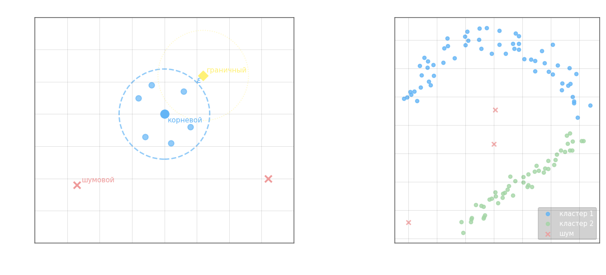

**DBSCAN** (Density-Based Spatial Clustering of Applications with Noise) — алгоритм кластеризации, основанный на плотности точек в окрестности, а не на расстоянии до центроида. В отличие от k-means, он не требует заранее задавать число кластеров и находит группы произвольной формы.

**Ключевые понятия.** Задаются два параметра: $\varepsilon > 0$ — радиус окрестности и $m \in \mathbb{N}$ — минимальное число точек. $\varepsilon$-окрестность объекта $x$:

$$U_\varepsilon(x) = \{u \in X^l : \rho(x, u) \leq \varepsilon\}$$

где $\rho$ — метрика в признаковом пространстве, $X^l$ — вся обучающая выборка.

**Три типа объектов:**

- **Корневой** — $|U_\varepsilon(x)| \geq m$: окрестность содержит не менее $m$ объектов; такие точки образуют «ядро» кластера
- **Граничный** — не корневой, но попадает в $\varepsilon$-окрестность хотя бы одного корневого объекта
- **Шумовой** — не корневой и не граничный; не принадлежит ни одному кластеру



**Алгоритм DBSCAN.**

Вход: выборка $X^l = \{x_1, \ldots, x_l\}$, параметры $\varepsilon$ и $m$.
Выход: разбиение на кластеры $K_1, K_2, \ldots$ и множество шумовых выбросов $N$.

**Идея простыми словами.** Кластер растёт как «пожар»: загорается от одной плотной (корневой) точки и перекидывается на всех её соседей. Если сосед тоже плотный — огонь идёт дальше от него. Если сосед неплотный (граничный) — он сгорает, но дальше огонь от него не идёт. Когда распространяться больше некуда, кластер готов — берём следующую ещё не тронутую точку и повторяем.

Обозначения: $U$ — объекты, которые ещё ни разу не рассматривались; $N$ — кандидаты в шум; $a$ — номер текущего кластера.

**Шаг 1. Подготовка.** Все точки считаем непросмотренными: $U \leftarrow X^l$. Шума пока нет: $N \leftarrow \emptyset$. Кластеров пока нет: $a \leftarrow 0$.

**Шаг 2. Берём любую непросмотренную точку $x \in U$ и считаем её соседей** — сколько точек лежит в круге радиуса $\varepsilon$ вокруг неё, то есть $|U_\varepsilon(x)|$ (сама $x$ тоже считается).

**Шаг 3. Соседей мало ($|U_\varepsilon(x)| < m$) — откладываем точку в шум.**

- $N \leftarrow N \cup \{x\}$, $U \leftarrow U \setminus \{x\}$ — точка просмотрена и помечена как _возможно_ шумовая
- Почему «возможно»: сама по себе точка неплотная, но позже может выясниться, что она лежит рядом с корневой точкой какого-то кластера. Тогда она окажется граничной и будет из шума «спасена» (см. шаг 4)
- Возвращаемся к шагу 2

**Шаг 4. Соседей достаточно ($|U_\varepsilon(x)| \geq m$) — $x$ корневая, запускаем новый кластер.**

- Заводим номер кластера: $a \leftarrow a + 1$
- Кладём в кластер всю окрестность: $K \leftarrow U_\varepsilon(x)$. Все соседи корневой точки точно принадлежат её кластеру — по определению они либо корневые, либо граничные
- **Расширяем кластер.** По очереди проходим точки $x' \in K$, которые ещё не просмотрены или лежат в шуме $N$, и для каждой считаем её соседей:
  - $|U_\varepsilon(x')| \geq m$ — $x'$ тоже корневая, значит её соседи тоже наши: $K \leftarrow K \cup U_\varepsilon(x')$. Новые точки встают в ту же очередь на проверку — так кластер «ползёт» по плотной области
  - $|U_\varepsilon(x')| < m$ — $x'$ граничная: она остаётся в кластере, но её соседей не добавляем. Именно поэтому кластер не «перетекает» через редкие точки в соседний кластер. Если $x'$ раньше попала в $N$, она оттуда уходит — её спасли
- Расширение заканчивается, когда в $K$ не осталось непроверенных точек: все корневые точки кластера уже раскрыты
- Всем точкам кластера ставим метку $a$ и убираем их из непросмотренных: $U \leftarrow U \setminus K$

**Шаг 5. Повторяем шаги 2–4, пока есть непросмотренные точки** ($U \neq \emptyset$). Каждая новая корневая точка, не попавшая ни в один из прошлых кластеров, открывает следующий кластер.

**Шаг 6. Итог.** Точки, оставшиеся в $N$ (их так и не «подобрал» ни один кластер), — шумовые выбросы. Остальные разбиты на кластеры $K_1, K_2, \ldots$

**Что важно запомнить:**

- Новый кластер может начать только корневая точка
- Расширяют кластер только корневые точки; граничные лишь присоединяются к нему
- Пометка «шум» не окончательная до конца алгоритма — граничную точку можно встретить раньше её кластера
- Граничная точка, лежащая рядом с корневыми точками двух разных кластеров, достаётся тому кластеру, который дошёл до неё первым (результат для таких точек зависит от порядка обхода)

Преимущества:

- Находит кластеры произвольной формы (полумесяц, спираль и т.д.) — недостижимо для k-means
- Не требует задавать число кластеров заранее
- Автоматически выделяет шумовые выбросы как отдельный «класс»
- Сложность $O(l \cdot \overline{|U_\varepsilon|})$ — при использовании пространственного индекса близко к $O(l \log l)$

Недостатки:

- При разной плотности кластеров единый $\varepsilon$ работает плохо
- Чувствителен к выбору $\varepsilon$ и $m$: их нужно подбирать под данные
- Плохо масштабируется на высокую размерность (проклятие размерности делает все точки «далёкими»)

**Числовой пример.** Восемь точек на плоскости, $\varepsilon = 1.5$, $m = 3$:

| Точка | Координаты |
| ----- | ---------- |
| A     | $(0, 0)$   |
| B     | $(1, 0)$   |
| C     | $(0, 1)$   |
| G     | $(2, 0)$   |
| D     | $(4, 4)$   |
| E     | $(5, 4)$   |
| F     | $(4, 5)$   |
| H     | $(8, 0)$   |

Для каждой точки вычислим $|U_\varepsilon(x)|$ — количество точек в $\varepsilon$-окрестности (включая саму точку):

| Точка | Соседи в $U_{1.5}$                                   | $\|U_\varepsilon\|$ | Тип                                      |
| ----- | ---------------------------------------------------- | ------------------- | ---------------------------------------- |
| A     | A, B $(\rho=1)$, C $(\rho=1)$                        | 3                   | **корневой**                             |
| B     | B, A $(\rho=1)$, C $(\rho\approx1.41)$, G $(\rho=1)$ | 4                   | **корневой**                             |
| C     | C, A $(\rho=1)$, B $(\rho\approx1.41)$               | 3                   | **корневой**                             |
| G     | G, B $(\rho=1)$                                      | 2                   | **граничный** ($G \in U_\varepsilon(B)$) |
| D     | D, E $(\rho=1)$, F $(\rho=1)$                        | 3                   | **корневой**                             |
| E     | E, D $(\rho=1)$, F $(\rho\approx1.41)$               | 3                   | **корневой**                             |
| F     | F, D $(\rho=1)$, E $(\rho\approx1.41)$               | 3                   | **корневой**                             |
| H     | H                                                    | 1                   | **шумовой**                              |

Алгоритм обрабатывает точки последовательно. Пусть первой взята A — корневая, создаём **кластер 1**: добавляем $U_\varepsilon(A) = \{A, B, C\}$. B тоже корневая → расширяем: $U_\varepsilon(B)$ добавляет G. G не корневая → присоединяется как граничная, не расширяет кластер. C корневая → $U_\varepsilon(C)$ не даёт новых точек. Кластер 1 = $\{A, B, C, G\}$.

Далее первой непомеченной окажется D — создаём **кластер 2** аналогично: D, E, F — все корневые, расширение не добавляет новых. Кластер 2 = $\{D, E, F\}$.

H не попала ни в один кластер — **шумовой выброс**.

Итог: два кластера $\{A, B, C, G\}$ и $\{D, E, F\}$, шум $\{H\}$.

---

- сам алгоритм

```python
# Алгоритм DBSCAN, взято с сайта: https://habr.com/ru/post/322034/

from itertools import cycle
from math import hypot
from numpy import random
import matplotlib.pyplot as plt


# идем по всем точкам внешним циклом, каждая точка посещается один раз
# (квадратичная сложность из-за region_query, который каждый раз перебирает все точки P)
# смотрим на точку:
# - если достаточное количество соседей,то
# - - то образуем из нее кластер, далее анализируем ее и всех ее подходящих соседей
# - если нет
# - - потенциально шумовая
def dbscan_naive(P, eps, m, distance):
    NOISE = 0 # ключ для шумовых элементов, то есть в clusters по ключу 0 будет лежать весь шум
    C = 0 # номер текущего кластера (счетчик)

    visited_points = set() # точка может быть посещенная, но не принадлежавшая какому-то кластеру
    clustered_points = set() # точки принадлежащие какому-либо кластеру
    clusters = {NOISE: []} # набор кластеров

    def region_query(p):
        return [q for q in P if distance(p, q) <= eps] # фильтр по расстоянию, сама p тоже попадает в список (distance(p, p) = 0)

    def expand_cluster(p, neighbours): # функция для создания нового кластера. Вход - корневая точка p и все ее соседи в eps-окрестности. p начинает новый кластер C: до вызова она не была ни в каком кластере (все точки кластеров уже посещены, а сюда приходят только непосещенные)
        if C not in clusters: # кластер C всегда новый, так как C только что увеличили, условие всегда выполняется
            clusters[C] = [] # то создать по индексу
        clusters[C].append(p) # точку в кластер
        clustered_points.add(p) # добавить точку как образующую кластер - С
        # цикл проверяет посещенная ли точка и есть ли она в кластере или в просмотренных
        # дополняя изначальных соседей которые были на вход функции
        while neighbours: # посмотрим на всех кто подходит по предварительному расстоянию
            q = neighbours.pop() # проверим каждого
            if q not in visited_points: # если точку еще не посещали - ветка расширения кластера: считаем соседей q и, если q корневая, добавляем их в очередь. Шумовые точки уже посещены во внешнем цикле, поэтому сюда не попадают и кластер не расширяют
                visited_points.add(q) # пометить как посещенную
                neighbourz = region_query(q) # найти всех соседей среди ВСЕХ точек у этой рассматриваемой точки
                if len(neighbourz) >= m: # q корневая
                    neighbours.extend(neighbourz) # то дополнить очередь всеми соседями q, дубликаты возможны, но повторно их отсекут проверки visited_points и clustered_points
            if q not in clustered_points: # если точка не принадлежит ни одному кластеру (граничная точка, уже забранная другим кластером, остается в нем - отсюда зависимость от порядка обхода)
                clustered_points.add(q) # добавить ее в точки, которые принадлежат кластеру
                clusters[C].append(q) # добавить ее в кластер С
                if q in clusters[NOISE]: # если была в шумовых - это граничная точка: неплотная, но рядом с корневой (ветка для удаления из шумовых)
                    clusters[NOISE].remove(q) # то удалить

    for p in P: # по всем точкам
        if p in visited_points: # мы ее посещали - пропускаем
            continue
        visited_points.add(p) # если не посещали, то помечаем как посещенную
        neighbours = region_query(p) # находим все кто подходит по расстоянию из ВСЕХ точек
        if len(neighbours) < m: # если их меньше заданного количества
            clusters[NOISE].append(p) # помечаем как потенциально шумовая
        else: # если их больше или равно m - точка корневая
            C += 1 # заводим номер нового кластера
            expand_cluster(p, neighbours) # разбираемся с соседями, которые близки по кластеру

    return clusters


# P = [(98, 62), (80, 95), (71, 130), (89, 164), (137, 115), (107, 155), (109, 105), (174, 62), (183, 115), (164, 153), (142, 174), (140, 80), (308, 123), (229, 171), (195, 237), (180, 298), (179, 340), (251, 262), (300, 176), (346, 178), (311, 237), (291, 283), (254, 340), (215, 308), (239, 223), (281, 207), (283, 156)]
# P = [(126, 63), (101, 100), (80, 160), (88, 208), (89, 282), (88, 362), (94, 406), (149, 377), (147, 304), (147, 235), (146, 152), (160, 103), (174, 142), (169, 184), (170, 241), (169, 293), (185, 376), (178, 422), (116, 353), (124, 194), (273, 69), (277, 112), (260, 150), (265, 185), (270, 235), (265, 295), (281, 351), (285, 416), (321, 404), (316, 366), (306, 304), (309, 254), (309, 207), (327, 161), (318, 108), (306, 66), (425, 66), (418, 135), (411, 183), (413, 243), (414, 285), (407, 333), (411, 385), (443, 387), (455, 330), (441, 252), (457, 207), (453, 149), (455, 90), (455, 56), (439, 102), (431, 162), (431, 193), (426, 236), (427, 281), (438, 323), (419, 379), (425, 389), (422, 349), (451, 275), (441, 222), (297, 145), (284, 195), (288, 237), (292, 282), (288, 313), (303, 356), (293, 395), (274, 268), (280, 344), (303, 187), (114, 247), (131, 270), (144, 215), (124, 219), (98, 240), (96, 281), (146, 267), (136, 221), (123, 166), (101, 185), (152, 184), (104, 283), (74, 239), (107, 287), (118, 335), (89, 336), (91, 315), (151, 340), (131, 373), (108, 133), (134, 130), (94, 260), (113, 193)]
P = [(64, 150), (84, 112), (106, 90), (154, 64), (192, 62), (220, 82), (244, 92), (271, 111), (275, 137), (286, 161),
     (56, 178), (80, 156), (101, 131), (123, 104), (155, 94), (191, 100), (242, 70), (231, 114), (272, 95), (261, 131),
     (299, 136), (308, 124), (128, 78), (47, 128), (47, 159), (137, 186), (166, 228), (171, 250), (194, 272),
     (221, 287), (253, 292), (308, 293), (332, 280), (385, 256), (398, 237), (413, 205), (435, 166), (447, 137),
     (422, 126), (400, 154), (389, 183), (374, 214), (358, 235), (321, 250), (274, 263), (249, 263), (208, 230),
     (192, 204), (182, 174), (147, 205), (136, 246), (147, 255), (182, 282), (204, 298), (252, 316), (312, 321),
     (349, 313), (393, 288), (417, 259), (434, 222), (443, 187), (463, 174)]

eps = 60  # размер эпсилон-окрестности
m = 5  # минимальное число объектов для полной эпсилон-окрестности

clusters = dbscan_naive(P, eps, m, lambda x, y: hypot(x[0] - y[0], x[1] - y[1]))
for c, points in zip(cycle('bgrcmykgrcmykgrcmykgrcmykgrcmykgrcmyk'), clusters.values()):
    X = [p[0] for p in points]
    Y = [p[1] for p in points]
    plt.scatter(X, Y, c=c)
plt.show()
```

- с помощью dbscan

```python
# Условие:
# Кластеризовать двумерную X через sklearn.DBSCAN(eps=55,min_samples=3) с евклидовой метрикой.
# По меткам fit_predict выделить точки кластеров 0,1,2 в X1,X2,X3, а шум с меткой -1 — в Noise.
# Самостоятельно повторить DBSCAN без sklearn и сравнить разбиение; не печатать.

import numpy as np
from sklearn.cluster import DBSCAN

X = [(166, 88), (147, 119), (133, 147), (113, 175), (91, 92), (120, 126), (146, 151), (172, 174), (94, 192), (187, 193),
     (328, 82), (299, 97), (277, 131), (280, 171), (299, 198), (348, 194), (378, 153), (372, 95), (222, 169),
     (332, 141), (69, 256), (110, 258), (139, 257), (179, 256), (210, 256), (248, 256), (295, 256), (322, 254),
     (350, 252), (377, 251), (400, 247), (403, 260), (378, 278), (341, 273), (306, 274), (277, 275), (245, 274),
     (222, 275), (193, 276), (170, 276), (147, 279), (120, 274), (91, 275), (65, 279)]
X = np.array(X)

# здесь продолжайте программу
clustering = DBSCAN(eps=55, min_samples=3, metric='euclidean')

res = clustering.fit_predict(X)
X1, X2, X3, Noise = [X[res == i] for i in [0, 1, 2, -1]]
```
