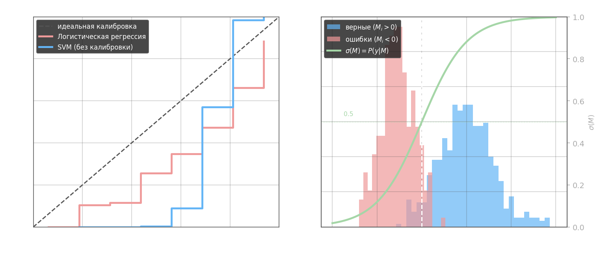
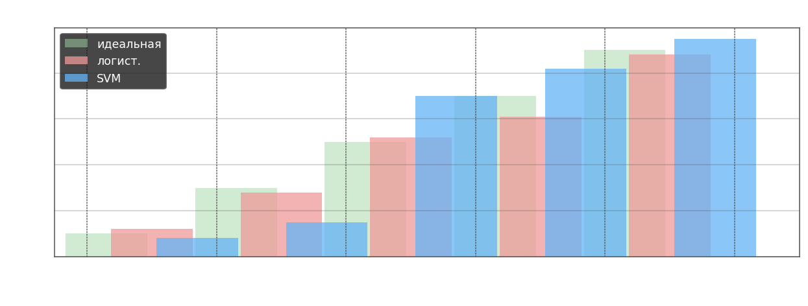

# калибровка

Доля аккуратности $\text{accuracy} = \frac{1}{k}\sum_{i=1}^k [a(x_i) = y_i] = \frac{1}{k}\sum_{i=1}^k [M_i > 0]$ показывает лишь число правильных ответов, но не говорит ничего о распределении ошибок по выборке и о том, насколько модель уверена в своих решениях. Два классификатора с одинаковой точностью могут вести себя принципиально по-разному: один уверенно правильно классифицирует большинство объектов и ошибается только на шуме, другой еле-еле переходит порог на большинстве примеров. Представление качества одним числом не информативно.

Отступ $M_i = y_i \cdot \langle \omega, x_i \rangle$ несёт больше информации: большой положительный отступ означает уверенную правильную классификацию, отрицательный — ошибку, значение около нуля — неуверенное решение на границе. Если использовать функцию потерь $\mathcal{L}(M_i) = \log(1 + e^{-M_i})$, то из неё естественно извлекается вероятность принадлежности к классу:

$$P(y \mid M) = \sigma(M) = \frac{1}{1 + e^{-M}}, \qquad \sigma(M) = P(y \mid x, \omega)$$

При $M = 0$ вероятность равна $0.5$ — полная неопределённость, при больших положительных $M$ она стремится к 1.

_Правый график. Ось X — отступ $M_i$, ось Y — количество объектов выборки. Синие столбцы — гистограмма отступов верно классифицированных объектов: они сосредоточены правее нуля, то есть модель уверенно относит их к правильному классу. Красные столбцы — гистограмма ошибок: они сосредоточены левее нуля. Зона около $M = 0$ — переходная: объекты с обоих классов перемешаны, модель неуверена. Зелёная кривая $\sigma(M)$ — сигмоида, наложенная поверх гистограммы: она показывает, какую вероятность $P(y \mid x)$ модель приписывает объекту с данным отступом. При $M = 0$ — ровно $0.5$, чем дальше от нуля вправо, тем ближе к $1$, влево — к $0$._

_Левый график. Ось X — предсказанная моделью вероятность $\hat{p}$, ось Y — реальная доля верных ответов среди всех объектов, которым модель присвоила вероятность $\hat{p}$. Если модель идеально откалибрована, точка $(\hat{p},\, \hat{p})$ лежит на диагонали: когда модель говорит «70% уверенности», ровно 70% таких предсказаний оказываются верными. Логистическая регрессия близка к диагонали. SVM систематически отклоняется: в средней зоне она предсказывает «около 0.5», но реальная доля верных ответов выше — модель недооценивает свою уверенность._

**Калибровка** отвечает на вопрос: насколько предсказанные вероятности $P(y \mid M_i)$ соответствуют реальным частотам правильных ответов? Здесь $P(y \mid M_i) = \sigma(M_i)$ — это вычисленная моделью вероятность принадлежности объекта $x_i$ к классу, число от 0 до 1. Для проверки отрезок $[0, 1]$ разбивается на диапазоны $P_0 = 0 < P_1 < P_2 < \ldots < P_n = 1$ (корзины, например $[0, 0.1),\, [0.1, 0.2),\, \ldots$), и алгоритм такой:

1. Для каждого объекта вычисляется $P(y \mid M_i)$
2. Объекты группируются по этому числу в корзины
3. В каждой корзине считается реальная доля верных ответов $\hat{f}_k$
4. Сравнивается: если модель говорит «0.7» — реально ли верных ~70%?

Для каждого диапазона вычисляется доля объектов выборки, у которых ответ действительно верный:

$$\text{для всех } x_i \text{ с } P(y = y_i \mid M_i) \in [P_k, P_{k+1}): \quad \hat{f}_k = \frac{1}{|B_k|}\sum_{i \in B_k} [a(x_i) = y_i]$$

где $B_k$ — множество индексов объектов, попавших в $k$-ю корзину (у которых $P(y \mid M_i) \in [P_k, P_{k+1})$), $|B_k|$ — размер корзины, а сумма $\sum_{i \in B_k} [a(x_i) = y_i]$ считает количество верно классифицированных среди них.

Если модель хорошо откалибрована, $\hat{f}_k \approx \frac{P_k + P_{k+1}}{2}$ — то есть ступенчатая кривая на графике «предсказанная вероятность vs доля верных» лежит вдоль диагонали.

Каждая группа столбцов — один диапазон предсказанных вероятностей $[P_k, P_{k+1})$. Высота столбца = реальная доля верных ответов среди объектов, попавших в этот диапазон. Зелёный (идеал) всегда совпадает с центром диапазона. Красный (логистическая) близок к идеалу. Синий (SVM) в средних диапазонах резко прыгает — модель предсказывает «около 0.5», но реальная доля верных уже 0.7, то есть SVM недооценивает свою уверенность в переходной зоне.\_

Логистическая регрессия по построению даёт вероятности, близкие к калиброванным — это следствие максимизации правдоподобия. SVM оптимизирует зазор, а не правдоподобие, поэтому выходные значения $\langle \omega, x \rangle$ не являются калиброванными вероятностями: модель может быть чрезмерно уверенной в одном регионе и неуверенной в другом.

**Почему у SVM нет калибровки изначально.** Логистическая регрессия минимизирует кросс-энтропию — функцию потерь, которая напрямую штрафует за неправильно оценённые вероятности. Поэтому модель «вынуждена» выдавать честные вероятности. SVM же минимизирует hinge loss $\max(0, 1 - M_i)$, которая заботится только о том, чтобы объекты оказались по правильную сторону границы с достаточным зазором. Ей всё равно, насколько далеко объект от границы — главное, что он за ней. В результате выходы SVM $\langle \omega, x \rangle$ — это геометрическое расстояние до гиперплоскости, а не вероятность: они могут быть произвольного масштаба и не обязаны лежать в [0, 1]. Когда их прогоняют через сигмоиду «в лоб», получают некалиброванные числа. Иначе говоря, hinge loss «срезает» всё, что правее $M_i = 1$ — в ноль: модель обучается только на объектах у границы (опорных векторах), а все остальные не дают градиента. Из-за этого масштаб выходов $\langle \omega, x \rangle$ не откалиброван — модель просто не получала обратной связи о том, насколько далеко объекты должны быть от границы. SVM можно дополнительно откалибровать, проведя **калибровку модели** — например, методом Платта (Platt scaling), который обучает логистическую регрессию поверх выходов SVM, или изотонической регрессией.

## Метод Платта (Platt scaling)

Метод Платта превращает «сырые» выходы SVM в откалиброванные вероятности, обучая поверх них логистическую регрессию. Пусть $f_i = \langle \omega, x_i \rangle$ — значение решающей функции SVM для объекта $x_i$. Тогда вероятность принадлежности к положительному классу определяется как:

$$P(y = +1 \mid f) = \frac{1}{1 + e^{A f + B}}$$

Параметры $A$ и $B$ подбираются максимизацией правдоподобия на **отдельной калибровочной выборке** — не той, на которой обучался SVM. Использовать обучающую выборку нельзя: SVM намеренно максимизирует зазор, поэтому на ней выходы $f_i$ смещены — опорные векторы искусственно скучены у границы, а остальные объекты отброшены далеко. На отложенной выборке такого смещения нет.

**Сглаженные метки.** Платт рекомендует не использовать жёсткие метки $\{0, 1\}$, а заменить их на:

$$t_+ = \frac{N_+ + 1}{N_+ + 2}, \qquad t_- = \frac{1}{N_- + 2}$$

где $N_+$ и $N_-$ — количество положительных и отрицательных объектов в калибровочной выборке. Это снижает переобучение при малом размере калибровочной выборки и учитывает неопределённость разметки.

**Функция потерь** для поиска $A$ и $B$ — кросс-энтропия:

$$\mathcal{L}(A, B) = -\sum_{i} \left[ t_i \log p_i + (1 - t_i) \log(1 - p_i) \right], \qquad p_i = \frac{1}{1 + e^{A f_i + B}}$$

минимизируемая градиентным спуском или методом Ньютона.

**Итог.** После обучения модель выдаёт: (1) решение $\text{sign}(f)$ — как исходный SVM; (2) вероятность $\sigma(Af + B)$ — откалиброванную. Параметр $A$ обычно отрицателен (потому что SVM с большим зазором «сжимает» выходы к нулю, а $A < 0$ растягивает их обратно); параметр $B$ смещает точку $P = 0.5$ туда, где реальная граница.

Помимо калибровки, качество модели оценивается через показатели, учитывающие асимметрию классов: **precision**, **recall** и **F-мера**, которые рассматриваются в следующих файлах этого раздела.
